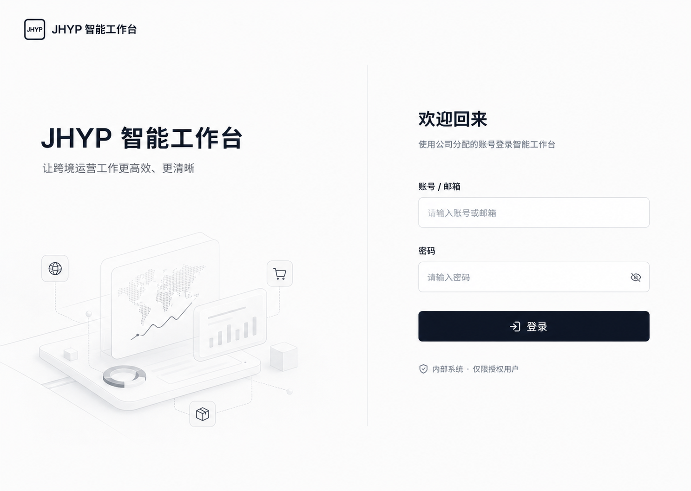

# 登录页视觉优化设计说明

## 1. 设计目标

将当前单列居中卡片登录页升级为专业、克制的双栏入口，提升内部工作台的品牌识别、可信度和空间利用率，同时保持登录流程、接口契约、权限与数据逻辑不变。

选定视觉目标：

视觉稿用于约束布局、比例、层级和氛围；项目现有 `Logo`、主题变量、shadcn/ui 组件和实际中文文案是实现时的权威来源。

## 2. 范围与边界

### 包含

- 登录页桌面端双栏布局。
- 左侧品牌信息和跨境运营主题装饰图。
- 右侧登录表单的信息层级、间距和控件尺寸。
- 移动端、平板端和暗色模式适配。
- 表单焦点、校验、加载和错误反馈的视觉一致性。

### 不包含

- 登录 API、JWT、权限、路由守卫或数据库修改。
- 注册、社交登录、忘记密码入口或额外认证方式。
- 对忘记密码页、OTP 页进行同步改版。
- 新增宣传型功能卡片、运营指标或与登录无关的信息。

## 3. 页面结构

### 桌面端

- 视口基准：`1440 × 1024`。
- 页面采用约 `56% / 44%` 的双栏结构。
- 左侧为品牌区，右侧为登录区，中间使用轻量垂直分隔线。
- 页面基于 `bg-background`，不使用悬浮大卡片或高对比背景卡套卡。
- 内容区保留充足边距，品牌区和表单区分别建立独立的最大宽度，避免宽屏拉伸。

### 品牌区

- 左上使用项目现有 `Logo` 与“JHYP 智能工作台”。
- 主标题为“JHYP 智能工作台”。
- 辅助文案为“让跨境运营工作更高效、更清晰”。
- 下方放置一张低对比、单色的跨境运营装饰图，表达数据洞察、增长趋势与全球业务。
- 装饰图仅承担氛围和品牌表达，不承载必须阅读的信息。
- 装饰图使用独立图片资产，不以临时 CSS 图形、内联 SVG 或卡片堆叠模拟。

### 登录区

- 标题为“欢迎回来”。
- 说明为“使用公司分配的账号登录智能工作台”。
- 表单字段保持“账号 / 邮箱”和“密码”。
- 主按钮保持“登录”，按钮宽度与输入框一致。
- 表单下方显示“内部系统 · 仅限授权用户”安全提示。
- 不增加忘记密码、注册或社交登录入口。

## 4. 视觉系统

- 颜色全部使用现有语义变量：`background`、`foreground`、`primary`、`muted`、`muted-foreground`、`border`、`input` 和 `ring`。
- 字体沿用项目配置的 Inter、Manrope 和系统中文无衬线字体。
- 圆角沿用现有 `--radius`，登录页不引入新的圆角体系。
- 输入框和按钮高度提升至约 `44px`，保证触控和键盘操作舒适度。
- 阴影仅用于必要的控件层级，页面主体主要依靠留白、对齐和分隔线组织。
- 图标继续使用 `lucide-react`，包括密码可见性和登录操作图标。
- 不使用渐变、霓虹、玻璃拟态或脱离项目风格的高饱和色。

## 5. 响应式与主题

### 大屏与桌面

- `lg` 及以上显示完整双栏布局和装饰图。
- 超宽屏限制内容最大宽度，保持表单宽度约 `400–440px`。

### 平板

- 保留双栏，但收紧品牌区文案和装饰图尺寸。
- 表单区域获得更高的可用宽度，避免字段过窄。

### 移动端

- 小于 `md` 时切换为单列。
- 隐藏非必要装饰图和中间分隔线。
- 品牌标识置于表单上方，表单占满可用宽度。
- 页面使用安全的纵向滚动，不依赖固定高度导致键盘遮挡。

### 暗色模式

- 页面结构和控件沿用现有暗色语义变量。
- 装饰图提供独立的浅色与暗色图片资产，不对图片使用可能造成脏边的强制反色。
- 暗色模式下检查边框、说明文字、占位文本和焦点环对比度。

## 6. 组件与兼容策略

- `AuthLayout` 增加向下兼容的 `centered` 与 `split` 布局变体，默认值保持 `centered`。
- `split` 变体接收品牌区内容，登录页显式使用该变体；忘记密码和 OTP 页面无需修改。
- `SignIn` 负责页面标题、品牌区和表单装配。
- `UserAuthForm` 只调整间距、控件尺寸和提示布局，不改变提交数据结构。
- 继续复用 `Button`、`Input`、`PasswordInput`、`Form` 和 `Logo`。
- 不新增基础 UI 控件，不修改全局主题 token。

## 7. 数据流与交互

1. 用户输入账号和密码。
2. Zod 与 react-hook-form 执行现有校验。
3. 提交时按钮进入加载状态并阻止重复提交。
4. 成功后继续保存用户与令牌，并跳转至原目标路由或首页。
5. 失败时继续显示现有错误反馈，不泄露账号是否存在。

数据流、请求地址、字段名称和成功跳转逻辑均保持不变。

## 8. 错误与状态

- 空字段和密码长度错误继续显示字段级错误。
- 输入框错误态使用现有 `aria-invalid`、`destructive` 和焦点环样式。
- 登录请求期间保留旋转加载图标，按钮文案不发生布局抖动。
- 请求失败继续使用统一提示：“账号或密码错误，或后端服务未启动。”
- 所有状态不改变表单整体尺寸，避免错误出现时页面明显跳动。

## 9. 可访问性

- 标题层级清晰，页面只保留一个主标题。
- 输入框保留可见标签，不以占位文本代替标签。
- 密码显示按钮保留明确的 `aria-label` 或屏幕阅读器文案。
- 键盘焦点顺序为账号、密码、显示密码、登录。
- 主要文字和控件满足 WCAG AA 对比度目标。
- 动效遵循 `prefers-reduced-motion`，不增加无必要的持续动画。

## 10. 验收标准

- `1440 × 1024` 下布局与选定视觉稿的双栏比例、层级和留白一致。
- `1024px`、`768px` 和 `390 × 844` 下无溢出、遮挡、裁切或横向滚动。
- 浅色与暗色主题均无视觉割裂。
- 正确账号可以登录，错误账号显示统一错误，空字段显示校验信息。
- 键盘可完成整个登录流程，焦点状态清晰。
- 忘记密码页和 OTP 页保持原有布局与行为。
- `pnpm run lint`、`pnpm run build` 和相关认证测试通过。

## 11. 风险与控制

- **共享布局影响**：通过默认值保持为 `centered` 的兼容变体隔离其他认证页。
- **装饰图主题适配**：使用独立明暗资产或安全隐藏策略，不强制反色。
- **视觉稿文字偏差**：实现时以项目真实文案和组件语义为准。
- **移动端键盘遮挡**：避免仅使用固定高度居中，允许页面自然滚动。
